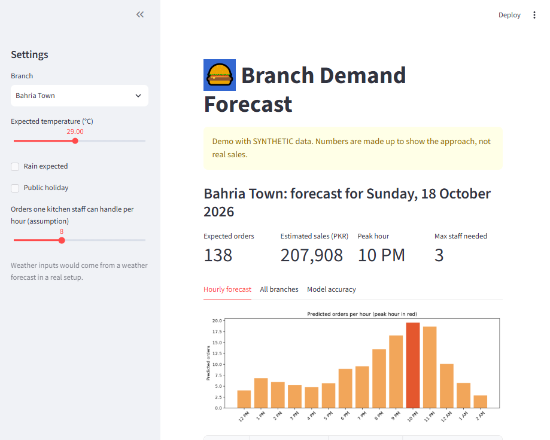
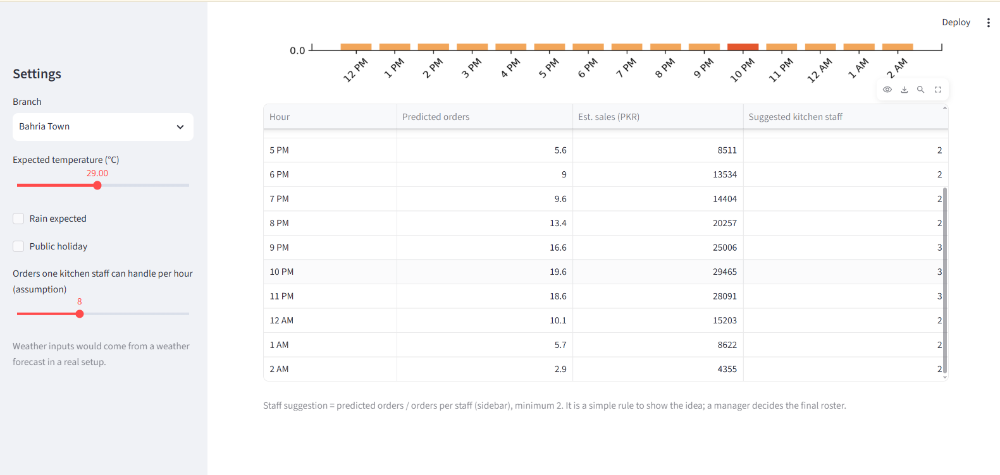
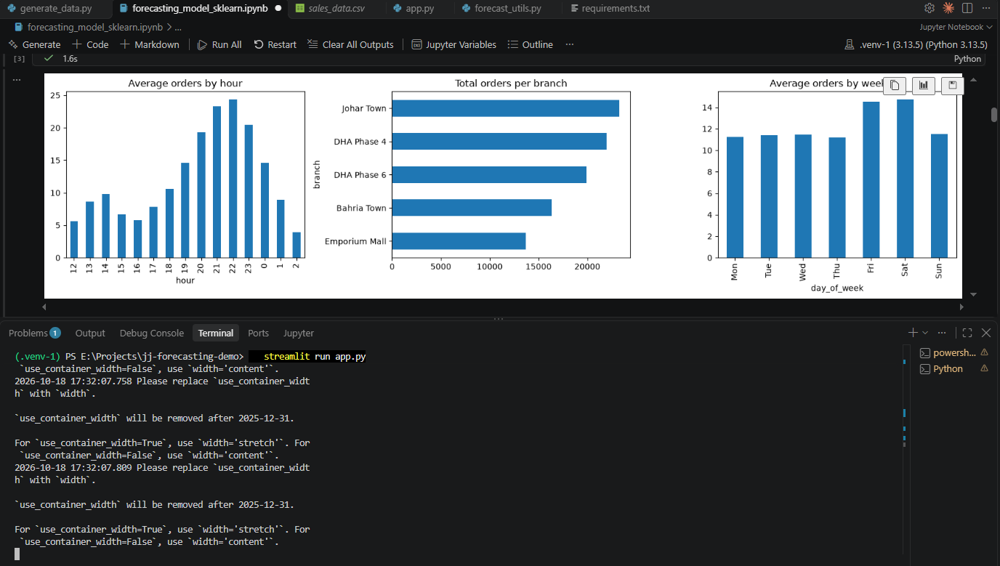
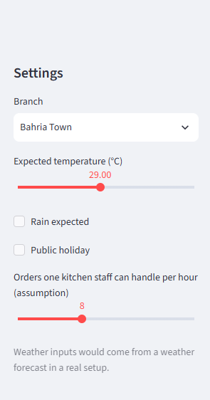
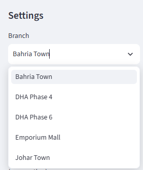
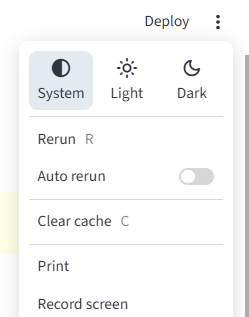

# Restaurant Demand Forecasting Dashboard (Demo)

Hourly order forecasting for a multi-branch restaurant chain, with a Streamlit dashboard that suggests expected demand and kitchen staffing per branch.

> **Important:** This project uses **synthetic (fake) data** generated by a script. It is a demo of the approach, not real sales data from any company. With real POS data, the model would be retrained and re-evaluated.

## Problem

Restaurants that cook fresh to order need to plan prep and staff before the rush. Guessing leads to either wastage (too much prep) or long waits (too little). This project forecasts orders per hour for each branch so managers can plan ahead.

## What it does

- Generates 3.5 months of hourly orders for 5 branches (weekend, holiday, rain and late-night patterns built in)
- Compares a **baseline** (same hour last week) with a **gradient boosting** model
- Shows next-day hourly forecast, estimated sales and a simple staffing suggestion in a Streamlit dashboard

## Results (last 14 days held out as test set)

| Model | MAE (orders/hour) | WAPE |
|---|---|---|
| Baseline (same hour last week) | 3.90 | 33.1% |
| Gradient boosting | 2.79 | 23.7% |

MAE dropped by about 28% versus the baseline. The data has random noise built in, so some error cannot be removed.


## Project structure

```
generate_data.ipynb            # creates sales_data.csv (synthetic)
forecasting_model_sklearn.ipynb# EDA, baseline, model, evaluation
forecast_utils.py              # feature building, training, next-day forecast
app.py                         # Streamlit dashboard
sales_data.csv                 # generated data
requirements.txt
```

## Run locally

```bash
pip install -r requirements.txt
streamlit run app.py
```

To regenerate the data, run `generate_data.ipynb` (it writes `sales_data.csv` next to the notebook).

## Method

- **Features:** hour, weekday, weekend/holiday flags, temperature, rain, branch, same hour last week, same hour yesterday, 7-day average for that hour
- **Split:** time-based (last 14 days for testing, no shuffling)
- **Metrics:** MAE, WAPE (MAPE is also computed on non-zero hours)
- **Model:** scikit-learn `HistGradientBoostingRegressor`

## Limitations and next steps

- Synthetic data: results will differ on real data
- Weather inputs are entered manually; a real setup would use a weather forecast
- Staffing rule is a simple orders-per-staff ratio; a manager makes the final decision
- Next: connect to real POS exports, add a natural-language Q&A box over the data, pilot on one or two branches

## 📸 Application Screenshots

### Screenshot 1



### Screenshot 2



### Screenshot 3


### Screenshot 4



### Screenshot 5



### Screenshot 6



### Screenshot 7




## Author

Muhammad Abdullah, Data Science graduate (BS Data Science, University of Okara)